## 项目

| 项目 | 研究方向 | 已实现内容 |
|---|---|---|
| [voxwright](https://github.com/ideapacket/voxwright) | 语音智能体应用层 | 确定性会话事件核心（record/replay/diff）、种子化场景工厂（植入任务结构/误听/对抗注入）、spoken-LLM 适配器协议（scripted/replay/loopback-mock/可选 torch）、防注入函数调用语法、frame-state 槽位接地与确认策略、确定性工作流引擎（补偿/回滚/字节一致 checkpoint-resume）、带权限工具沙箱与防篡改副作用账本、有界误听修复策略、应用层 barge-in 原子语义、多模态上下文管理（预算驱逐/PII 脱敏/引用接地）、逻辑时钟延迟分账、任务成功率/tool-F1 评测切片、自验证 SVG/HTML 报告与完整 CLI |

## 技术栈

## 活动

<picture>
  <source media="(prefers-color-scheme: dark)" srcset="https://raw.githubusercontent.com/ideapacket/ideapacket/output/github-snake-dark.svg" />
  <source media="(prefers-color-scheme: light)" srcset="https://raw.githubusercontent.com/ideapacket/ideapacket/output/github-snake.svg" />
  
</picture>

## 当前关注

- 语音智能体的可信工具执行：权限模型、防注入语法与防篡改副作用账本的组合保证。
- 确定性重放工程：逻辑时钟、字节一致 checkpoint/resume 与会话 diff 的可验证性。
- 误听修复与 barge-in 的应用层语义：有界修复循环、幂等标注与原子回滚。
